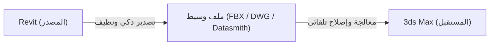

# محادثة رقم 22: ايه اللي موجود في الملف   <ADDITIONAL_METADATA> The current local time is: 2026-10-31T12:30:25+03:00. </ADDITIONAL_METAD
- **Conversation ID:** `69e31696-dff1-4147-9fd1-d0e6a32659d9`
- **Start Date:** `2026-10-31T09:30:25Z`
- **Total Turns:** 9

---

### 👤 User (2026-10-31T09:30:25Z)
ايه اللي موجود في الملف 

<ADDITIONAL_METADATA>
The current local time is: 2026-10-31T12:30:25+03:00.
</ADDITIONAL_METADATA>
<USER_SETTINGS_CHANGE>
The user changed setting `Model Selection` from None to Gemini 3.8 Flash (High). No need to comment on this change if the user doesn't ask about it. If reporting what model you are, please use a human readable name instead of the exact string.
</USER_SETTINGS_CHANGE>

---

### 👤 Antigravity (Gemini) (2026-10-31T09:30:52Z)
الملف الموجود في المجلد هو ملف فيديو بعنوان:
**`WhatsApp Video 2026-10-27 at 12.33.31.mp4`** (مدته حوالي **3 دقائق و10 ثوانٍ**).

---

### محتوى الفيديو بالتفصيل:
الفيديو عبارة عن **شرح عملي لطريقة تصدير ونقل بلوك (مجسم أثاث/دولاب) من برنامج 3ds Max إلى برنامج Revit** بطريقة صحيحة وخفيفة تمنع ثقل الملف أو حدوث تشوهات:

1. **فحص عدد الـ Polygons (المضلعات):**
   * عزل المجسم (`Isolate`) وفحص عدد الـ Polys، حيث كان عدده كبيراً (حوالي 34,000).
   * التنويه إلى أن النطاق المفضل للريفيت يكون في حدود 15,000 إلى 25,000 لتجنب ثقل الملف.

2. **تطبيق الموديفاير الأول (`ProOptimizer`):**
   * عمل حسابات للمجسم بالضغط على `Calculate`.
   * تقليل النسبة (بين 10% إلى 25%) بالتجربة لتقليل عدد الـ Polys إلى رقم مقبول دون تشويه تفاصيل المجسم.

3. **تطبيق الموديفاير الثاني (`Edit Mesh`):**
   * الدخول على مستوى الحواف (`Edges`) وتحديد جميع الحواف وعملها **`Invisible`** لإخفاء الخطوط الداخلية والتقسيمات المشوهة.

4. **تصدير المجسم (Export):**
   * عمل `Export Selected` بصيغة **`OBJ`** (تم حفظه باسم `01.obj`).

5. **استيراد المجسم داخل Revit:**
   * فتح الريفيت وعمل **`Model In-Place`** واختيار التصنيف المناسب (تم اختيار **Furniture** للدولاب).
   * من قائمة `Insert` اختيار **`Import CAD`** واختيار صيغة `OBJ` واختيار الملف.
   * ضبط وحدة القياس (`Units`) لتكون متطابقة مع الماكس (مثلاً بالسنتيمتر).
   * إنهاء الموديل بـ `Finish` واستعراضه بنجاح في منظور الـ 3D.

6. **ملاحظة مهمة وحلها (أخذ الأبعاد 2D Dimensions):**
   * أشارت إلى أن العيب الوحيد لملفات OBJ في الريفيت هو صعوبة أخذ الأبعاد (`Dimensions`) في المساقط الثنائية (2D).
   * **الحل المذكور:** رسم خطوط خفيفة (`Detail/Model Lines`) على الحدود الخارجية للمجسم لتسهيل التقاط الأبعاد والمقاسات.

---

### 👤 User (2026-10-31T09:32:47Z)
طيب انا عايز اخرج ملف من الريفيت للماكس بدون ما اي حاجه تبوظ فيه 

<ADDITIONAL_METADATA>
The current local time is: 2026-10-31T12:32:47+03:00.
</ADDITIONAL_METADATA>

---

### 👤 Antigravity (Gemini) (2026-10-31T09:32:47Z)
لتحقيق أفضل نتيجة عند تصدير مشروع من **Revit** إلى **3ds Max** بدون حدوث تشوهات في المجسمات، أو تجميد في حركة الماكس (Lag)، أو ضياع للخامات، توجد طريقتان معتمدتان من Autodesk.

---

### أولاً: تجهيز ملف الريفيت (أهم مرحلة لمنع أي مشاكل)

1. **أنشئ 3D View مخصص للتصدير:**
   * انسخ المنظور الثلاثي وسمّه مثلاً: `{3D - To 3ds Max}`.
2. **اخفِ العناصر غير الضرورية (`VG / Visibility Graphics`):**
   * من قائمة `Annotation Categories`: اخفِ المحاور (`Grids`) والمناسيب (`Levels`) وسكاشن القطع (`Section Boxes`).
   * من قائمة `Imported Categories`: تأكد من إخفاء أي ملفات أوتوكاد مربوطة (CAD Links).
   * اخفِ العناصر التي ستستبدلها في الماكس ببلوكات ذات جودة أعلى (مثل: الأشخاص، والأشجار RPC، والفرش البسيط إن وجد).
3. **تأكد من قرب المبنى من نقطة الصفر (Origin):**
   * احرص ألا يكون المشروع بعيداً جداً عن نقطة الأصل (Internal Origin)، لأن البُعد الشديد يسبب اهتزازاً وتكسيراً في أسطح الماكس (Floating-point jitter).

---

### الطريقة الأولى (الأفضل والأحدث): الربط المباشر من الماكس (`Link Revit`)

هذه الطريقة ممتازة لأنها تبقي الملفين مرتبطين؛ فإذا عدّلت أي جدار أو شباك في الريفيت، يمكنك بضغطة زر واحدة (`Reload`) تحديث التعديلات في الماكس دون إعادة العمل على الخامات.

1. افتح **3ds Max**، ومن القائمة العلوية:
   `File` ➔ `Import` ➔ **`Link Revit`**.
2. اختر ملف الريفيت (`.rvt`).
3. ستظهر لك نافذة:
   * **Select 3D 
<truncated 379 bytes>
# الطريقة الثانية: التصدير بصيغة `FBX`

إذا كنت تفضل نقل الملف كملف مستقل:

#### 1. داخل Revit:
* تأكد أنك تقف في المشهد `3D - To 3ds Max`.
* اذهب إلى: `File` ➔ `Export` ➔ **`FBX`**.
* احفظ الملف في مكان معروف.

#### 2. داخل 3ds Max:
* اذهب إلى: `File` ➔ `Import` ➔ **`Import`** واختر ملف الـ FBX.
* ستفتح لك نافذة إعدادات الـ FBX:
  1. في خيار **Preset**: اختر **`Autodesk Revit - Architectural`**.
  2. في قسم **File Content / Combine Entities**: اختر **`By Revit Material`** (إياك أن تختار *Do not combine*، لأنها ستنزل كل طوبة وعنصر كـ Object منفصل مما يعطل الماكس).
  3. تأكد من تفعيل خيار **`Smoothing Groups`**.
  4. في خانة **Units**: تأكد أنها متطابقة مع وحدات ملفك.
  5. اضغط **OK**.

---

### أهم 3 نصائح لتجنب أي أخطاء شائعة:

1. **ضبط الوحدات (Units):**
   * داخل الماكس قبل الاستيراد، اذهب إلى `Customize` ➔ `Units Setup` ➔ `System Unit Setup` وتأكد أن وحدة النظام (System Units) متطابقة مع الريفيت (مثلاً: Meters أو Centimeters).
2. **علاج التكسير أو التسويد في المنحنيات (Cylinders / Arches):**
   * لو ظهر أي سطح منحني فيه سواد أو تكسير تظليل (Normal shading issue)، ضع عليه موديفاير **`Smooth`** وفعّل **Auto Smooth**، أو استخدم موديفاير **`Weighted Normals`**.
3. **تعديل الخامات:**
   * الخامات التي تأتي من الريفيت تكون خامات عامة (Autodesk Materials)؛ إذا كنت تستخدم محرك رندر مثل **V-Ray** أو **Corona**، يمكنك تحويلها جميعاً بضغطة زر واحدة باستخدام أداة:
     * **`V-Ray Scene Converter`** أو **`Corona Converter`**.

---

### 👤 User (2026-10-31T10:28:14Z)
عايز اعمل اداه تطلع ملفات الريفيت للماكس بدون اي مشاكل 

<ADDITIONAL_METADATA>
The current local time is: 2026-10-31T13:28:14+03:00.
</ADDITIONAL_METADATA>

---

### 👤 Antigravity (Gemini) (2026-10-31T10:28:14Z)
فكرة ممتازة ومطلوبة جداً، لأن الربط اليدوي بين الريفيت والماكس يعاني منه معظم معماريي الإظهار (ArchViz).

لبناء أداة احترافية (Plugin / Bridge) تقوم بهذه المهمة بدون أي مشاكل، نحتاج أولاً لتحديد **مكان عمل الأداة وطبيعتها**:

---

### خيارات بناء الأداة (3 مسارات):

1. **أداة داخل 3ds Max (الأسهل والأكثر طلباً - MaxScript / Python):**
   * تفتح الماكس وتختار ملف الريفيت أو الـ FBX.
   * الأداة تقوم بـ:
     * توحيد وضبط الـ System Units تلقائياً.
     * استيراد وتجميع العناصر حسب الخامة (`Combine by Material`).
     * معالجة المنحنيات وإصلاح التكسير بإضافة `Weighted Normals` أو `Auto Smooth` تلقائياً.
     * تحويل الخامات بضغطة زر إلى **Corona** أو **V-Ray**.

2. **أداة داخل Revit (إما C# Add-in أو pyRevit):**
   * تضيف زر في شريط أدوات الريفيت: **"Export to 3ds Max"**.
   * تنشئ مشهداً ثلاثياً نظيفاً وتخفي تلقائياً (المناسيب، المحاور، الكاد، الـ RPC، الـ Annotations).
   * تنقل نقطة الأصل (Origin) للمركز لمنع مشاكل الـ Jittering.
   * تصدر الملف بإعدادات دقيقة.

3. **جسر متكامل (Full Bridge - ضغطة زر واحدة من الطرفين):**
   * تضغط Export في الريفيت، فيفتح الماكس تلقائياً ويستورد المشهد معالجاً ونظيفاً وجاهزاً للرندر.

---

### المشاكل التقنية التي يجب أن تعالجها الأداة كودياً:

| المشكلة في النقل العادي | الحل الذي ستقوم به الأداة برمجياً |
| :--- | :--- |
| **تجميد الماكس (آلاف العناصر المنفصلة)** | دمج العناصر المتشابهة في خامة واحدة (`Attach by Material`) |
| **تكسير المنحنيات والسواد في الشيدنج** | تطبيق موديفاير `Weighted Normals` وتعيين `Auto Smooth` |
| **اختلاف المقاسات والسكيل** | فحص ومطابقة `System Units` مع وحدات الريفيت قبل الاستيراد |
| **شوائب خطوط الكاد والمحاور** | فلترة كل ما هو ليس Geometry نظيف من التصدير |
| **الخامات غير المتوافقة** | سكربت يحول خامات Autodesk التلقائية لخامات V-Ray أو Corona |

---

### لكي نبدأ فوراً في كتابة كود الأداة، وضح لي تفضيلك:

1. **أين تفضل أن تعمل الأداة؟**
   * أداة داخل **3ds Max** (نكتبها بلغة MaxScript أو Python في الماكس بواجهة مستخدم بسيطة).
   * أم أداة داخل **Revit** (C# Add-in أو pyRevit).
   * أم **الاثنين معاً**؟
2. **ما هو محرك الرندر الذي تستخدمه في 3ds Max؟**
   * Corona Renderer
   * V-Ray
   * خامات عادية (Physical / Standard)

---

### 👤 User (2026-10-31T10:31:23Z)
الاثنين معاً؟

اديني اختيارات سواء CORONA أو VRAY أو PHYSICAL او STANDARD او لل LUMION و هكذا 

<ADDITIONAL_METADATA>
The current local time is: 2026-10-31T13:31:23+03:00.
</ADDITIONAL_METADATA>

---

### 👤 Antigravity (Gemini) (2026-10-31T10:31:23Z)
*الأدوات المنفذة: `write_file`*

لقد صممت لك **حلاً متكاملاً وموحداً (Universal Bridge)** يتكون من شقين:
1. **أداة ريفيت (Revit Side):** سكريبت ذكي ينشئ منظورا نظيفاً (`Auto 3D Clean View`)، ويخفي كل الخطوط والكاد والمحاور، ويضبط الإحداثيات للصفر ويصدر الملف بنقاوة تامة.
2. **أداة الماكس (3ds Max Side):** أداة متطورة بواجهة مستخدم (UI) تقوم بـ:
   * ضبط الـ System Units وإصلاح التكسير وتطبيق `Weighted Normals`.
   * دمج العناصر حسب الخامة لتخفيف المشهد.
   * **محرك تحويل خامات متكامل (Material Engine):** يدعم التحويل الفوري إلى:
     * **Corona Renderer** (`CoronaPhysicalMtl`)
     * **V-Ray** (`VRayMtl`)
     * **Autodesk Physical** (Arnold / Viewport)
     * **Standard Material** (Scanline / Games)
   * **زر خاص لـ Lumion:** تحسين المجسم وتصديره كملف FBX خفيف بدون أخطاء ومطابق لمتطلبات لوميون مع تضمين الخامات.

---

سنقوم الآن بإنشاء ملفات الأداة داخل المجلد `d:\_Course\3dsmax Plugins\Universal_Bridge`.

### 1. كتابة أداة 3ds Max (`Universal_Revit_Bridge.ms`)

---

### 👤 Antigravity (Gemini) (2026-10-31T10:35:09Z)
تم إنشاء الحزمة البرمجية الكاملة بنجاح باسم:
**`Universal Revit to 3ds Max & Lumion Bridge`** داخل المجلد:
[`d:\_Course\3dsmax Plugins\Universal_Bridge`](file:///d:/_Course/3dsmax%20Plugins/Universal_Bridge)

تتكون الأداة من شقين متكاملين لتغطية كافة متطلباتك مع دعم كامل لـ **Corona، V-Ray، Physical، Standard، و Lumion**:

---

### مكونات الأداة:

#### 1. أداة 3ds Max: [`Universal_Revit_Bridge.ms`](file:///d:/_Course/3dsmax%20Plugins/Universal_Bridge/Universal_Revit_Bridge.ms)
واجهة تحكم متكاملة داخل الماكس تحتوي على:
* **استيراد ومعالجة تلقائية (Import & Mesh Fix):**
  * دمج الكتل المتشابهة بالخامة تلقائياً لمنع ثقل الماكس وتجميده (`Combine by Material`).
  * معالجة تشوهات الأسطح والمنحنيات تلقائياً عبر تطبيق موديفاير `Weighted Normals` و `AutoSmooth`.
  * لحام النقاط المفتوحة (`Weld`) لمنع تسريب الإضاءة.
* **محول خامات فوري (Material Engine):**
  * **Corona Renderer** ➔ يحول الخامات إلى `CoronaPhysicalMtl` أو `CoronaMtl`.
  * **V-Ray** ➔ يحول الخامات إلى `VRayMtl`.
  * **Physical Material** ➔ لخامات أوتوديسك القياسية (جاهزة للـ Arnold والـ Viewport).
  * **Standard (Scanline)** ➔ الخامات الكلاسيكية المناسبة لمحركات الألعاب.
* **تصدير لوميون (Export for Lumion):**
  * زر مخصص لتصدير ملف FBX مُعالج ونظيف تماماً للوميون مع تضمين الخامات بداخله (`Embed Textures`) وتثليث الأوجه لتجنب أي أخطاء في الـ UV أو التظليل.

---

#### 2. أداة Revit: [`Revit_Side_pyRevit`](file:///d:/_Course/3dsmax%20Plugins/Universal_Bridge/Revit_Side_pyRevit)
* سكريبت بايثون متوافق مع إضافة **pyRevit** يضيف زر **`Export to Max/Lumion`** داخل واجهة الريفيت.
* **وظيفته:**
  1. ينشئ تلقائياً مشهداً ثلاثياً نظيفاً باسم `{3D - To 3ds Max & Lumion}`.
  2. يخفي كل المحاور (`Grids`) والمناسيب (`Levels`) والسكاشن وخطوط الأبعاد والـ Annotations.
  3. يخفي ملفات الكاد المربوطة (`CAD Links`).
  4. يضبط مستوى التفاصيل على `Fine` ويصدر الملف كـ FBX نظيف وجاهز للماكس بضغطة زر.

---

### طريقة التشغيل السريعة:

1. **في 3ds Max:**
   * اسحب الملف [`Universal_Revit_Bridge.ms`](file:///d:/_Course/3dsmax%20Plugins/Universal_Bridge/Universal_Revit_Bridge.ms) وأفلته بالماوس داخل شاشة الماكس (أو من قائمة `Scripting` ➔ `Run Script`).
   * اضغط على **`Import Revit FBX / File`** واختر ملفك.
   * اختر محرك الرندر (Corona / V-Ray / Physical / Standard) واضغط **`Convert All Materials Now`**.
   * إذا كنت تريد الإرسال إلى لوميون، اضغط مباشرة على **`Export Clean FBX for Lumion`**.

2. **دليل الاستخدام المفصل بالعربي:**
   * يمكنك قراءة كافة التفاصيل وخطوات التثبيت في ملف الشرح: [`README_AR.md`](file:///d:/_Course/3dsmax%20Plugins/Universal_Bridge/README_AR.md).

---

