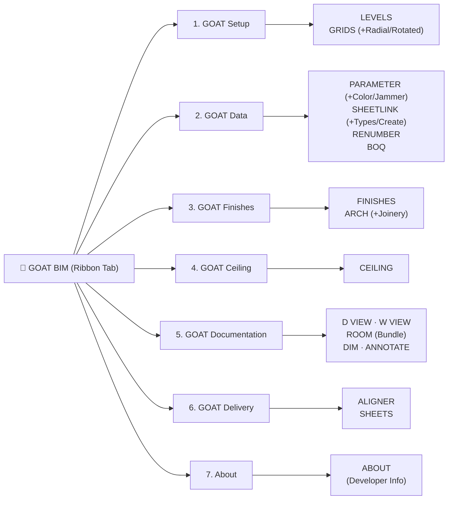

# 🐐 الدستور الهندسي الشامل وخطة التنفيذ: حزمة GOAT BIM Suite
**Target:** Autodesk Revit 2026 / 2027 (`.NET 10.0` / `C#` / `WPF`)  
**Developer:** Eng. Abdelaziz Osman (أبو ياسين)  
**Design Philosophy:** *"Less is More"* — Dark Navy Identity (`#0F172A`) + High-Performance Automation

---

## 1️⃣ الهوية البصرية والبراند الجديد (`GOAT BIM`)
* **توحيد البراند بالكامل:** تحويل اسم الحزمة بالكامل من `OR Tools` إلى **`GOAT BIM`**.
* **اسم التاب الرئيسية في الريفيت:** `GOAT BIM`
* **الهيدر والبانر في كل النوافذ:** شعار **`GOAT BIM`** باللون الكحلي الداكن (`#0F172A`) مع الأخضر الزمردي (`#10B981`) والأزرق السماوي (`#38BDF8`).
* **الأيقونات (`32x32` & `16x16`):** توليد وتحديث الأيقونات لكل الأدوات بنفس الهوية الموحدة.

---

## 2️⃣ هيكل الـ Ribbon النهائي (6 لوحات رئيسية + About)

---

## 3️⃣ القواعد المعمارية والتقنية المعتمدة (Core Rules)

> [!IMPORTANT]
> **الركائز الـ 5 الأساسية لكل أداة في الحزمة:**
> 1. **نوافذ غير حاجبة (`Modeless Windows + ExternalEvent`):** تظل النوافذ مفتوحة للتفاعل الحر مع الموديل واختيار العناصر بدون إغلاق الشاشة.
> 2. **التراجع بضغطة واحدة (`One Ctrl+Z`):** تغليف كل عملية بـ `TransactionGroup` وإنهائها بـ `Assimilate()` ليتراجع المستخدم عن أي عملية مركبة بضغطة `Ctrl+Z` واحدة.
> 3. **التحديث الذكي بدون تكرار (`Smart Replace / Update`):** في `GOAT FINISHES` و `GOAT CEILING`، يتم تمييز العناصر المتولدة بكود الغرفة؛ وعند إعادة التشغيل على نفس الغرفة يتم مسح التشطيب القديم تلقائياً ووضع الجديد مكانه.
> 4. **محرك `.xlsx` مدمج بالكامل:** توليد وقراءة ملفات إكسيل `.xlsx` حقيقية بدون الحاجة لوجود برنامج الإكسيل، مع دعم تعدد الشيتات `(Instances)` و `(Types)`، تلوين الخلايا (Read-Only رمادي، المعدل أصفر)، ومعادلات `TEXTJOIN`.
> 5. **حفظ الإعدادات تلقائياً (`%AppData%\GOATBIM`):** حفظ آخر إعدادات المستخدم وقواعده بصيغة JSON.

---

## 4️⃣ المواصفات التفصيلية للأدوات (16 أداة)

| اللوحة (Panel) | الأداة (Tool) | المواصفات والقرارات المعتمدة |
| :--- | :--- | :--- |
| **1. GOAT Setup** | **`LEVELS`** | توليد وإدارة المناسيب بارامترياً مع تحديث الـ Header لبراند `GOAT BIM`. |
| | **`GRIDS`** | توليد المحاور الأفقية، الرأسية، المائلة (`Rotated`)، والدائرية (`Radial Grids`). |
| **2. GOAT Data** | **`PARAMETER`** | تعديل جماعي + **Color Splasher** (تلوين المسقط حسب القيمة) + **Spatial Room Injector** (كتابة رقم/اسم الغرفة داخل العناصر) + **Combine Formula** + **Isolate in View**. |
| | **`SHEETLINK`** | ربط ثنائي بالإكسيل + فصل شيت `(Types)` عن `(Instances)` + تلوين الخلايا وشاشة مقارنة (`Diff Preview`) + **إنشاء لوحات وغرف جديدة من صفوف الإكسيل**. |
| | **`RENUMBER`** | ترقيم شامل (`Rooms, Doors, Windows, Grids, Sheets, Viewports`) بـ 3 أوضاع: (Pick، Auto-Direction، و **Door by Room `101A, 101B`**) مع منع تحذير تكرار الأرقام (`Auto-Swap`). |
| | **`BOQ`** | استخراج ومقارنة جداول الكميات والمقايسات (BOQ Builder) مباشرة من الموديل للإكسيل. |
| **3. GOAT Finishes** | **`FINISHES`** | شاشة ثلاثية (قائمة الغرف مع فحص صحة الغرفة `Room Health Check` + 6 تبويبات `Walls, Skirting, Floors, Ceilings, Data, Options` + معاينة Plan/Section حية) + دعم الوزرات كـ `Wall Types` و `Wall Sweeps` + امتداد الأرضيات تحت الأبواب (`Door Threshold`) + `Auto-Join` لفتح الشبابيك والأبواب + مطابقة بارامتر الغرفة مع الرجوع للـ Default + تصدير حصر الإكسيل. |
| | **`ARCH`** | نافذة من تبويبين: **Tab 1: Arch Generator** (عقود نصف دائرية، مدببة، حدوة فرس، إلخ مع Void يفتح الحائط) + **Tab 2: Wardrobe / Joinery Builder** (توليد الدواليب والنجارة بارامترياً). |
| **4. GOAT Ceiling** | **`CEILING`** | إنشاء السقف المعلق الناقص تلقائياً + توزيع شبكي (`Lighting, Diffusers, Sprinklers, Detectors`) يدعم الـ **Ceiling/Face-Hosted** والـ **Level-Based** تلقائياً + تفادي الأعمدة + كتابة رقم الغرفة في الـ `Comments`. |
| **5. GOAT Documentation** | **`D VIEW` & `W VIEW`** | توليد لوحات تفاصيل الأبواب والشبابيك والفتحات (4 مساقط + جدول) بضغطة واحدة. |
| | **`ROOM`** | محرك توثيق الغرف الشامل (على طريقة **Glyph**): توليد (`Enlarged Plan`, `RCP`, `Interior Elevations` بالوضعين `4-Way N/S/E/W` أو `Parallel to All Walls` حتى المائلة، و `3D Section Box`) + تفعيل مباشر لـ (`Auto-Dim`, `Auto-Tag`, `Auto-Pack on Sheet`). |
| | **`DIM`** | أبعاد ذكية للمساقط (أبعاد الغرف الداخلية + 3 سلاسل خارجية للمبنى) + **أبعاد الواجهات والقطاعات** (مناسيب الشبابيك والأبواب والأسقف) مع `Auto-Stacking`. |
| | **`ANNOTATE`** | وضع التاجات الذكي لكافة الفئات المختارة مع **خوارزمية منع التداخل (`Tag Collision Avoidance`)** وترتيب التاجات. |
| **6. GOAT Delivery** | **`ALIGNER`** | **Auto-Pack Views on Active Sheet** (رص المساقط تلقائياً في اللوحة وتوحيد خط العنوان) + **Match Position Across Sheets** + **Duplicate Sheet with Views/Legends/Schedules**. |
| | **`SHEETS`** | تصدير دفعي متعدد الصيغ (`PDF, DWG, DGN, DWF, NWC, IFC, IMG` + شيت `ISO 19650 DocRegister`). |
| **7. About** | **`ABOUT`** | نافذة معلومات المطور: **Abdelaziz Osman** مع أزرار تفاعلية لفتح البريد (`abdelazizothman.eg@gmail.com`)، حساب LinkedIn، وحساب Behance، ورقم الإصدار. |

---

## 5️⃣ خطة التنفيذ على 4 دفعات (Execution Sprints)

* **🚀 الدفعة الأولى (Sprint 1 — الأساس والتشطيبات):**
  1. ترقية الهوية بالكامل إلى **`GOAT BIM`** وتقسيم الـ Ribbon للـ **6 Panels + About** وتوليد كل الأيقونات.
  2. بناء محرك الإعدادات العام (`GoatSettingsManager`) ومحرك `.xlsx` المدمج.
  3. برمجة نافذة **`ABOUT`** ببياناتك وروابطك.
  4. برمجة أداة **`GOAT FINISHES`** كاملة (WPF UI + Live Plan/Section Preview + Revit API Engine + Excel QTO).
  5. برمجة أداة **`GOAT ARCH`** (تبويب العقود المعمارية + تبويب الدواليب/النجارة).
  6. عمل `dotnet build` كامل والتأكد من جاهزية التثبيت (`Install.cmd`).
* **📐 الدفعة الثانية (Sprint 2 — الأسقف والتوثيق الذكي Glyph-Style):**
  - برمجة `GOAT CEILING` + `GOAT DIM` + `GOAT ANNOTATE` + `GOAT ROOM` (Bundle Engine).
* **📊 الدفعة الثالثة (Sprint 3 — إدارة البيانات والترقيم CTC/DiRoots-Style):**
  - برمجة `GOAT RENUMBER` + `GOAT BOQ` + ترقية `GOAT PARAMETER` و `GOAT SHEETLINK`.
* **📦 الدفعة الرابعة (Sprint 4 — التسليم والمحاذاة والـ Installer النهائي):**
  - برمجة `GOAT ALIGNER` + ترقية `GOAT GRIDS` (Radial/Rotated) + ترقية `Install.ps1` النهائي.
